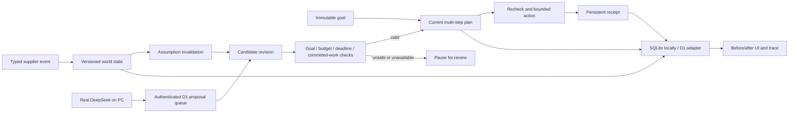

# Architecture

The pure world, assumptions, runner, policy and action modules are shared by the local and hosted adapters. The local store serializes mutations with `BEGIN IMMEDIATE`, storing state, stock, receipts and audit trace together. The D1 adapter saves one bounded sandbox payload through revision comparison; conflicts reload and recheck the same request. Test compatibility uses actual SQLite behind a D1-shaped interface; this does not substitute for an actual Cloudflare runtime check.

Reservations belong to the run. Available-stock events describe unreserved stock and cannot erase a held reservation. Cancellation before collection releases the hold with a separate receipt. Collection/dispatch are committed work; a model cannot rewrite them. Repeat step requests return the original receipt.

Model calls execute on the PC and are explicit and bounded. The public Site queues a proposal in D1; the PC claims it through authenticated outbound HTTPS, invokes the supported client, and returns a result. One claim and an expiring lease prevent duplicate inference. Heartbeat readiness expires when the PC disconnects. The genuine supported Claude Code client has tools and MCP disabled. The server reserves an attempt before inference, then checks the exact goal/world/reservation context again before accepting the result. Separate advance controls execute steps. Model failure or an operator pause prevents execution. Reservation budgets are application allowances, not a promise about provider billing.

Local SSE publishes committed state updates; heartbeats never invoke planning. Hosted reconnect catch-up returns the full bounded durable state. Supplier observations in this demo are fixtures, not externally authenticated feeds. The audit SHA-256 chain detects changes relative to its stored chain; it has no external signed anchor.
