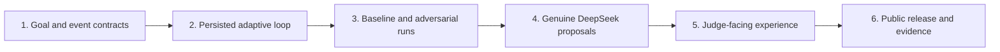

# Introduction

Chosen mission: [The Adaptive Agent](https://build.doo.ooo/challenges/adaptive-agent). Official requirements and rubric were read in the signed-in browser on October 14, 2026. This is a new project, separate from submitted Threshold and Relay Trust. The local application, genuine AI verification, comparison tests and locally tested hosted staging now exist. The continuous walkthrough is recorded and verified. The public Site is deployed and has passed 101 runtime checks; The reviewed GitHub source is published. Competition submission remains pending.

Pivot coordinates delivery of 12 repair kits within a fixed budget and deadline. Its initial multi-step plan becomes invalid when a supplier loses stock or its ETA changes. The system identifies the invalidated assumption, retains completed work, proposes a revision and validates it before the next effect. When revision is unsafe, it pauses for operator review.

The quality method is: define the falsifiable outcome, implement the smallest full loop, break it, measure both agents on identical inputs, then polish the explanation and release evidence. Each phase passes its gate before dependent work starts. A passing test suite alone does not complete a phase requiring live or public evidence.

## 1. Requirements & Constraints

- **REQ-001**: Persist a multi-step plan and continuously validate its assumptions when world events arrive. A fixed polling or re-prompt timer is not the change detector.
- **REQ-002**: Persist every accepted revision with prior plan ID, triggering event, changed assumption, evidence version, concise explanation, proposed diff, policy result and retained completed effects.
- **REQ-003**: Demonstrate stock loss and ETA delay using the same initial plan, goal, event stream, clock, action gateway and starting inventory for the frozen-plan baseline and adaptive agent.
- **REQ-004**: Display a failed adaptation: an over-budget replacement is refused without reserving stock, changing the goal or writing a dispatch effect.
- **REQ-005**: Supply a clean-clone public repository, anonymous working demo, architecture snapshot, deliberate failure evidence, a continuous 90-second walkthrough, a thesis of at most 300 words and explicit AI/scope notes. The official checklist calls video optional; this plan includes it.
- **REQ-006**: Record genuine local DeepSeek v4 Flash requests, validated proposals, reported usage and resulting revisions. Public recorded/cached proposals must be labeled as replay and bound to the exact world/goal hash. An unrecorded model success must not be invented.
- **SEC-001**: Server-owned goals, budgets, deadline, quantity and authority are immutable during adaptation. Model output may propose steps but cannot supply permissions or alter constraints.
- **SEC-002**: Apply each synthetic effect atomically after current world/plan version checks. Replays return the existing receipt. Reservation cancellation is compensating work; it is never described as undoing an actual completed delivery.
- **SEC-003**: Reject stale, duplicate and invalid source events; persist the reason. Untrusted event text cannot set source identity, sequence, budget or policy. Source identity in the demo is configured, not a claim of external attestation.
- **SEC-004**: Keep credentials, local databases, client state and private configuration out of screenshots, exports, Git history and public deployment. Allow only synthetic fixture data in public model evidence.
- **CON-001**: Use integer cents and a deterministic simulation clock starting at minute 0. Goal: 12 kits, maximum total cost 27000 cents, delivery no later than minute 180. Supplier A: 1800 cents/kit, 12 available, remaining lead time 60 minutes; supplier B: 2100 cents/kit, 12 available, remaining lead time 90 minutes. Shipping costs 1200 cents. Compute arrival as current minute plus remaining lead time. Initial A total is 22800; B total is 26400. Both disruption events arrive at minute 10: stock loss is before the initial reservation; the ETA-delay scenario reserves A at minute 5, then increases its remaining lead time to 210 minutes before collection/dispatch. B replacement at minute 10 arrives at minute 100. A reservation cancellation before collection releases the entire hold at zero cancellation fee; never debit two supplier orders to represent the replacement.
- **CON-002**: Maximum 3 accepted revisions per run, 2 compensating cancellations, 100 input events and one outstanding planning request. Repeated invalidation after the revision budget pauses the run. An irrelevant change produces zero new planning calls.
- **CON-003**: Default development is local and synthetic. Paid model access stays local unless a supported, secret-safe hosted integration is separately verified. No new public deployment, submission or cross-chat message is part of this roadmap task.
- **GUD-001**: Judge-facing language explains what changed, what remains fixed, what action was avoided and what the revised plan costs. Distinguish observed results from counterfactual forecasts.
- **PAT-001**: Separate planner, event intake, assumption validator, revision policy and action adapter. A model is a proposal producer; persisted state controls progress.

## 2. Implementation Steps

### Implementation Phase 1

- **GOAL-001**: Freeze the mission contract and two reproducible scenarios. Gate: a scenario validator recomputes both costs and expected assumption failures from JSON.

| Task | Description | Completed | Date |
|------|-------------|-----------|------|
| TASK-001 | Write `docs/mission-map.md` mapping each official requirement/rubric criterion to an observable result and evidence path. Preserve the distinct mission question: safe change of plan over time. | Yes | 2026-10-14 |
| TASK-002 | Add `fixtures/stock-loss.json` and `fixtures/eta-delay.json` using CON-001, initial 4-step plan `reserve -> collect -> dispatch -> confirm`, and events with `id`, `source`, `sequence`, `observedAt`, `worldVersion` and typed payload. | Yes | 2026-10-14 |
| TASK-003 | Implement `src/contracts.js::validateGoal`, `validateWorldEvent` and `validateCandidatePlan`; disallow unknown fields and unsupported step types. Add `scripts/check-fixtures.mjs` to assert total A=22800, total B=26400, replacement arrival=10+90=100<=180, and delayed A arrival=10+210=220>180. Depends on TASK-002. | Yes | 2026-10-14 |

### Implementation Phase 2

- **GOAL-002**: Execute one entire adaptive run with durable state. Gate: restart after observation and recover the same revision, pending steps and receipts. Depends on GOAL-001.

| Task | Description | Completed | Date |
|------|-------------|-----------|------|
| TASK-004 | Implement `src/world.js::applyEvent` and `src/assumptions.js::findInvalidatedAssumptions`; deduplicate event IDs, require monotonically increasing source sequence, distinguish relevant changes from noise and identify reservation versus available-stock semantics. | Yes | 2026-10-14 |
| TASK-005 | Implement `src/store.js::createRun`, `appendObservation`, `saveRevision`, `applyStep` and `exportRun` with Node SQLite. Persist goals, per-source sequence, world versions, plan revisions, step state, reservations, receipts and trace events. | Yes | 2026-10-14 |
| TASK-006 | Implement `src/runner.js::advance` with states `planned`, `executing`, `observing`, `replanning`, `paused`, `completed`, `failed`; one outstanding revision; completed-effect preservation; revision/compensation limits; and cancellation of stale proposals. Depends on TASK-004 and TASK-005. | Yes | 2026-10-14 |
| TASK-007 | Implement `src/policy.js::validateRevision` and `src/actions.js::applySyntheticStep`. Before a write, verify goal, budget, deadline, inventory, reservation ownership, plan version and allowed compensation. Store stock mutation and receipt in the same transaction. Depends on TASK-005 and TASK-006. | Yes | 2026-10-14 |

### Implementation Phase 3

- **GOAL-003**: Establish fair comparison and contain failed adaptation. Gate: both positive fixtures pass all hard constraints; adversarial runs produce zero forbidden effects. Depends on GOAL-002.

| Task | Description | Completed | Date |
|------|-------------|-----------|------|
| TASK-008 | Implement `src/baseline.js::runFrozenPlan` and `src/comparison.js::compareRuns`. Clone identical initial state and events into isolated runs. Keep the same action-boundary checks; the baseline does not revise. Do not weaken safety to manufacture a win. Show its uncorrected forecast separately from its observed blocked/late result. | Yes | 2026-10-14 |
| TASK-009 | Add `test/adaptation.test.js` for stock loss, delayed ETA after reservation, unrelated noise, duplicate/out-of-order events, preserved completed steps, restart, deterministic replay and stale model result. Run every fixture without paid inference. | Yes | 2026-10-14 |
| TASK-010 | Add `test/containment.test.js` for replacement over budget, changed deadline/quantity, malicious event prose, reservation race, duplicate dispatch and repeated A/B signal flips. Assert fixed goals and no over-budget, duplicate or stale effect. | Yes | 2026-10-14 |
| TASK-011 | Implement `scripts/compare.mjs` reporting goal achieved, constraint violations, spend, arrival minute, revisions, compensation count and planning calls for each run. Save inputs, model-independent outputs and metrics to `outputs/comparison-report.json`. Depends on TASK-008 to TASK-010. | Yes | 2026-10-14 |

### Implementation Phase 4

- **GOAL-004**: Demonstrate genuine AI planning under the established constraints. Gate: real provider responses generate the initial and revised plans; independently checked evidence explains any rejection. Depends on GOAL-003.

| Task | Description | Completed | Date |
|------|-------------|-----------|------|
| TASK-012 | Implement `src/planner.js::proposePlan` behind a provider interface. Add `src/deepseek-client.js` using the verified supported Claude Code transport; tools/MCP disabled, bounded output, no automatic execution, retries or fallback. Load a server-only ignored `.env` at runtime; do not copy a key into source. | Yes | 2026-10-14 |
| TASK-013 | Implement persistent attempt reservations in `src/inference-budget.js`: at most 6 attempts/run and 18000 reserved tokens/run, each reserving 3000 before invoking the client. Reject oversized context; persist attempt/timeout status; reported provider usage is separate from the reservation. Give timeout failures a paused state. | Yes | 2026-10-14 |
| TASK-014 | Run `scripts/verify-ai-run.mjs` against stock and ETA scenarios; record provider/model, input hashes, returned proposals, timestamps, reported usage, accepted/rejected revisions and final receipts. Export only allowlisted synthetic content through `scripts/export-public-evidence.mjs`. Audit real outcomes rather than asserting a success in advance. Depends on TASK-012 and TASK-013. | Yes | 2026-10-14 |

### Implementation Phase 5

- **GOAL-005**: Make the change of mind understandable to a stranger. Gate: desktop/mobile browser QA shows both full runs, old/new assumptions and containment without reading source. Depends on GOAL-003; AI evidence view also depends on GOAL-004.

| Task | Description | Completed | Date |
|------|-------------|-----------|------|
| TASK-015 | Add `server.js` and `public/index.html`, `public/app.js`, `public/style.css` with scenario chooser, side-by-side timeline, fixed goal card, revision diff, event inspector, operator pause and export. Implement `/api/run`, `/api/events`, `/api/advance`, `/api/trace` with strict body limits, scoped sessions, CSRF/origin checks and bounded runs. | Yes | 2026-10-14 |
| TASK-016 | Implement local SSE `/api/stream` to deliver accepted events to the UI, with ordered event IDs and reconnect recovery. Planning remains triggered by semantic invalidation, not by stream heartbeat or timer. Use durable server state and expose an explicit catch-up cursor for the hosted adapter. | Yes | 2026-10-14 |
| TASK-017 | Validate keyboard interaction, mobile widths 390 and 1280, readable before/after diffs, restart recovery and distinct live versus recorded AI labels. Capture the two successful changes and the refusal/paused failure case. Depends on TASK-015 and TASK-016. | Yes | 2026-10-14 |

### Implementation Phase 6

- **GOAL-006**: Produce an inspectable public submission package. Gate: anonymous demo opens, clean clone passes checks, live effects and video verify, and every submitted claim points to evidence. Depends on GOAL-004 and GOAL-005.

| Task | Description | Completed | Date |
|------|-------------|-----------|------|
| TASK-018 | Implement `hosted/worker.js` and `hosted/store.js` with D1-backed bounded sessions and compare-and-swap writes using the shared pure contracts, assumptions and policy. Use the current Sites skill/starter workflow at build time. Test local/hosted semantic parity, quotas, retention, session isolation and concurrent effects. Hosted scenarios and any recorded model proposals must be explicitly labeled. | Yes | 2026-10-14 |
| TASK-019 | Write `README.md`, `.env.example`, `docs/architecture.md`, `docs/thesis.md` (<=300 words), `docs/failure-test.md` and `docs/ai-usage.md`. Scan current files, history and evidence for secrets/private runtime paths before proposing public publication. | Yes | 2026-10-14 |
| TASK-020 | Prepare a continuous 90-second actual UI recording: 0-15s goal/initial plan; 15-35s stock event; 35-55s revision diff and baseline divergence; 55-75s over-budget revision contained; 75-90s persisted receipt/limits. If model requests are executed before capture, disclose cached proposals. Require recovered MP4, decoded frames and verified duration. A continuous user-selected tab capture was recovered as H.264 MP4 (90.70 seconds, 584×672); full decoding and sampled success/failure frames were checked. | Yes | 2026-10-14 |
| TASK-021 | After publication authorization, publish a sanitized public repository and Sites demo, verify anonymous links and exact commits, then prepare notes <=2000 characters with architecture/thesis/evidence links. Submit only after explicit submission authorization and save the actual DOO confirmation. Update usage checks between work chunks and stop at 30% remaining of the five-hour Codex window. Public Site deployed; 101 anonymous runtime checks and exact video hash passed. GitHub and submission state are tracked in release evidence. | No | In progress |

## 3. Alternatives

- **ALT-001**: Simulate Before You Act was inspected. Its real write/rollback requirement suggests a separate adapter project; this roadmap concentrates on changing plans as evidence changes.
- **ALT-002**: Repeatedly prompt a model on a timer. Reject because it supplies no explicit invalidation logic and is disqualified by the chosen brief.
- **ALT-003**: Let a model redefine the budget/deadline to make its revised plan succeed. Reject because it changes the mission rather than adapting safely.
- **ALT-004**: Publish a generic chat interface and a narrated screenshot sequence as the main evidence. Reject for this build: use a temporal comparison and continuous observed run.

## 4. Dependencies

- **DEP-001**: Node.js >=24 and built-in SQLite/cryptography/HTTP for the local application. Prefer built-in modules; additional packages require a specific need and locked versions.
- **DEP-002**: Genuine supported Claude Code client and an authorized AgentRouter DeepSeek v4 Flash account for GOAL-004. Provider failure blocks AI evidence, not deterministic core verification.
- **DEP-003**: Current ChatGPT Sites publishing workflow and D1 binding for GOAL-006; read the installed skill at execution time. Publication credentials stay transient.
- **DEP-004**: User action may be needed to select browser screen capture, sign in or approve a legally binding form. Prepare the concrete deliverable before that handoff.

## 5. Files

- **FILE-001**: `src/contracts.js`, `fixtures/*.json`, `scripts/check-fixtures.mjs` define the immutable goal and event contracts.
- **FILE-002**: `src/world.js`, `src/assumptions.js`, `src/store.js`, `src/runner.js`, `src/policy.js`, `src/actions.js` implement durable adaptation and bounded effects.
- **FILE-003**: `src/baseline.js`, `src/comparison.js`, `scripts/compare.mjs` provide fair replay and metrics.
- **FILE-004**: `src/planner.js`, `src/deepseek-client.js`, `src/inference-budget.js`, `scripts/verify-ai-run.mjs`, `scripts/export-public-evidence.mjs` provide actual model integration and sanitized evidence.
- **FILE-005**: `server.js`, `public/*`, `hosted/worker.js`, `hosted/store.js` provide local/hosted experiences without publishing local inference credentials.
- **FILE-006**: `test/*.test.js`, `docs/*`, `README.md`, `.env.example`, `outputs/*` provide reproducibility and release evidence.
- **FILE-007**: `roadmap.html` is the current interactive planning board; it is not a running fulfillment agent.

## 6. Testing

- **TEST-001**: Same initial state, goal, event stream and gateway for both agents; fixtures are replayable and costs recompute exactly.
- **TEST-002**: Stock event before reservation invalidates A's availability. Only the adaptive run selects a valid replacement. No plan revision on an unrelated event.
- **TEST-003**: ETA event after reservation requires explicit compensating cancellation and alternative allocation; committed work remains in the trace and budget accounting.
- **TEST-004**: Stale/out-of-order/duplicate events, restart and concurrent reservations cannot yield stale approval or duplicate effects.
- **TEST-005**: An over-budget, unauthorized or malformed AI revision is rejected with zero corresponding reservation/dispatch effects; fixed goals remain identical.
- **TEST-006**: Source noise, conflicting signals and model timeout respect event/revision/call budgets and end in an explainable paused state.
- **TEST-007**: Real AI verification asserts returned schema, world/goal hash, usage provenance and accepted/rejected receipts; mock tests alone are not provider proof.
- **TEST-008**: Public runtime parity, quotas, CSRF/origin, session isolation, anonymous reachability and video recovery/duration must be checked on actual published artifacts.

## 7. Risks & Assumptions

- **RISK-001**: Reusing familiar UI or logic could obscure the adaptive mission. The primary screen and proof focus on temporal assumptions, revisions and fair comparison.
- **RISK-002**: Source events and ETAs may be wrong. Use freshness/order checks, explicit uncertainty and pause on unresolved conflicts; do not portray synthetic fixture truth as external verification.
- **RISK-003**: A local transport cannot be assumed to run in the hosted runtime. Keep the public event loop independent and clearly label genuine local AI evidence.
- **RISK-004**: Compensation after partial execution can double-spend or misrepresent undo. Track reservation ownership, remaining stock, prior receipts and explicit compensation budgets.
- **ASSUMPTION-001**: Synthetic fulfillment tasks are acceptable evidence for this brief when honestly labeled; the observed brief permits realistic synthetic data and does not require real purchases.
- **ASSUMPTION-002**: Model availability and pricing can change. Verify the chosen client/model before integration; do not promise a dollar cost or substitute another model silently.
- **ASSUMPTION-003**: A roadmap prepares future build work. No application completion, test result, deployment or new challenge submission is claimed by creating this plan.

## 8. Related Specifications / Further Reading

- [Official Adaptive Agent brief](https://build.doo.ooo/challenges/adaptive-agent), read live October 14, 2026. Rubric: conceptual clarity 25, technical depth 25, demo quality 20, failure thinking 15, thesis 15.
- [Threshold source](https://github.com/m7mdd77/threshold-decision-engine): reference for action-boundary, concurrency and receipt patterns; a separate submitted mission.
- [Relay Trust source](https://github.com/m7mdd77/relay-trust): reference for trustworthy evidence disclosure; a separate submitted mission.
- [Compared simulation mission](https://build.doo.ooo/challenges/simulate-before-act), read live October 14, 2026.
